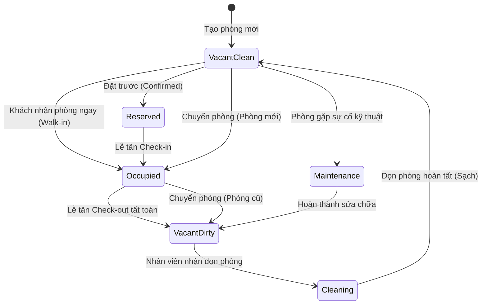
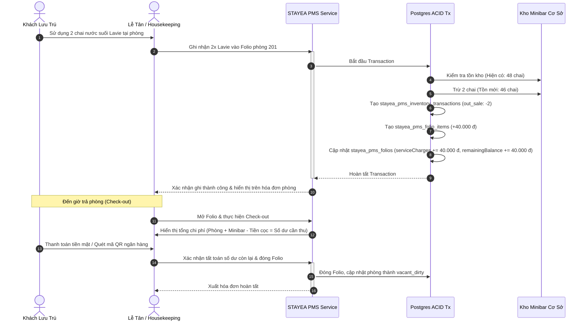

# Kiến Trúc Quản Lý Vận Hành Cơ Sở Lưu Trú (STAYEA PMS)

Tài liệu này mô tả chi tiết mô hình kiến trúc, quy trình nghiệp vụ, cơ sở dữ liệu, API và giao diện của phân hệ **Property Management System (PMS)** dành cho đối tác khách sạn, resort và homestay trên nền tảng STAYEA (tham chiếu theo chuẩn vận hành OHotel).

---

## 1. Nguyên Tắc Thiết Kế & Phân Định Ranh Giới

1. **Phân biệt Lịch Tồn Marketplace (`stayea_partner_inventory`) với Tồn Phòng Vật Lý (`stayea_pms_rooms`)**:
   - `stayea_partner_inventory`: Quản lý hạn ngạch (slots) mở bán theo ngày của một bài đăng dịch vụ lưu trú trên sàn thương mại điện tử STAYEA.com (ví dụ: ngày 15/11 mở bán 5 phòng).
   - `stayea_pms_rooms`: Quản lý từng phòng vật lý cụ thể trong khuôn viên cơ sở (Phòng 101, 102, 201...) thuộc về đối tác (`partner_id`).
   - Khi có đơn đặt phòng từ marketplace (`stayea_bookings`), lễ tân có thể chọn gán phòng vật lý còn trống trong sơ đồ phòng PMS.

2. **Bảo toàn dữ liệu & Kiểm toán tài chính (Financial Auditability)**:
   - Hồ sơ thanh toán (`stayea_pms_folios`) và các dòng chi phí (`stayea_pms_folio_items`) **không bao giờ bị xóa cứng (hard delete)**.
   - Hủy khoản phí (void) được đánh dấu mềm `is_cancelled = true`, ghi nhận lý do bắt buộc, tên nhân viên thực hiện, thời điểm và tự động hoàn trả tồn kho nếu là mặt hàng vật lý.
   - Thao tác nhạy cảm (đổi phòng, hủy phí, điều chỉnh kho) được ghi vào `stayea_pms_audit_logs`.

3. **Chống Overbooking & Đảm bảo Tính Toàn Vẹn Giao Dịch (ACID Transactions)**:
   - Các luồng tạo đặt phòng, nhận phòng, đổi phòng và xuất bán minibar đều được bọc trong `db.transaction()`.
   - Kiểm tra trùng lịch phòng vật lý theo nguyên tắc giao thời gian:
     `lte(expectedCheckIn, targetCheckOut) AND gte(expectedCheckOut, targetCheckIn)`.

4. **Tách biệt Doanh Thu Quầy và Doanh Thu Nền Tảng**:
   - Khoản thu phát sinh tại quầy (tiền phòng walk-in, minibar, giặt ủi, phụ thu) thuộc 100% doanh thu trực tiếp của đối tác cơ sở lưu trú.
   - Không hạch toán nhầm doanh thu minibar của khách sạn vào GMV/Commission của STAYEA Marketplace.

---

## 2. Mô Hình Dữ Liệu (10 Bảng Drizzle ORM)

| Bảng CSDL | Mục đích & Nghiệp vụ |
| :--- | :--- |
| `stayea_pms_room_types` | Hạng phòng của cơ sở (Standard, Deluxe, Villa ban công...), giá cơ bản, giá giờ, sức chứa, tiện nghi. |
| `stayea_pms_rooms` | Phòng vật lý cụ thể (số phòng, tầng, trạng thái phòng, trạng thái buồng phòng housekeeping). |
| `stayea_pms_reservations` | Lượt đặt phòng & lưu trú (walk-in, phone, marketplace, OTA; ngày giờ đến/đi, tiền cọc). |
| `stayea_pms_folios` | Hồ sơ thanh toán (tiền phòng, minibar, phụ thu, chiết khấu, tổng cộng, đã thanh toán, còn phải thu). |
| `stayea_pms_folio_items` | Dòng chi phí chi tiết (nước suối, giặt ủi, phụ thu), lưu nhân viên ghi nhận và trạng thái hủy mềm. |
| `stayea_pms_folio_payments` | Lịch sử các đợt thanh toán (tiền mặt, chuyển khoản QR, thẻ POS, cọc trước). |
| `stayea_pms_service_items` | Danh mục minibar, đồ uống, giặt ủi, giá bán, giá vốn, tồn kho hiện tại, ngưỡng cảnh báo. |
| `stayea_pms_inventory_transactions` | Nhật ký xuất nhập tồn kho, tự động tạo khi bán minibar cho phòng hoặc nhập hàng. |
| `stayea_pms_staff_roles` | Phân quyền nhân viên cơ sở (chủ cơ sở, quản lý, lễ tân, thu ngân, housekeeping). |
| `stayea_pms_audit_logs` | Nhật ký kiểm toán mọi thao tác thay đổi phòng, hủy phí và điều chỉnh kho. |

---

## 3. Vòng Đời Vận Hành Buồng Phòng (Room Lifecycle & Housekeeping)

- **Mã màu chuẩn trên Sơ Đồ Phòng (Room Rack)**:
  - 🟢 **Xanh lá (`vacant_clean`)**: Phòng trống đã dọn sạch sẵn sàng đón khách.
  - 🟡 **Vàng hổ phách (`vacant_dirty`)**: Phòng trống chưa dọn (khách vừa trả phòng). Bấm 1-click "Báo đã dọn sạch" để chuyển về `vacant_clean`.
  - 🔴 **Đỏ (`occupied`)**: Đang có khách ở. Hiển thị tên khách, số ngày ở, dư nợ folio hiện tại, nút mở Folio & Checkout.
  - 🔵 **Xanh dương (`reserved`)**: Đã có khách đặt trước sắp đến. Nút 1-click "Nhận phòng ngay (Check-in)".
  - ⚪ **Xám (`maintenance`)**: Phòng đang sửa chữa/bảo trì.

---

## 4. Quy Trình Bán Minibar, Xuất Kho & Tất Toán Folio

---

## 5. Danh Sách REST API Phân Hệ PMS

Tất cả các endpoint thuộc controller `/api/stayea/pms`:

### 5.1 Quản Lý Phòng & Hạng Phòng
- `GET /api/stayea/pms/room-types?partnerId=...`: Lấy danh sách hạng phòng.
- `POST /api/stayea/pms/room-types?partnerId=...`: Tạo hạng phòng mới.
- `GET /api/stayea/pms/rooms?partnerId=...&floor=...&status=...`: Lấy sơ đồ phòng vật lý kèm trạng thái buồng phòng.
- `POST /api/stayea/pms/rooms?partnerId=...`: Tạo phòng vật lý mới.
- `PATCH /api/stayea/pms/rooms/:id/status?partnerId=...`: Cập nhật trạng thái phòng / buồng phòng.

### 5.2 Lễ Tân & Đặt Phòng
- `GET /api/stayea/pms/reservations?partnerId=...&status=...`: Danh sách lượt đặt phòng & khách lưu trú.
- `POST /api/stayea/pms/reservations?partnerId=...`: Tạo đặt phòng (walk-in hoặc đặt trước, hỗ trợ check-in ngay).
- `POST /api/stayea/pms/reservations/:id/check-in?partnerId=...`: Làm thủ tục nhận phòng, phụ thu đến sớm nếu có.
- `POST /api/stayea/pms/reservations/:id/check-out?partnerId=...`: Làm thủ tục trả phòng, tất toán folio, chuyển phòng thành cần dọn.
- `POST /api/stayea/pms/reservations/:id/transfer-room?partnerId=...`: Đổi phòng an toàn (ghi audit log, chuyển phòng cũ sang cần dọn).

### 5.3 Folio & Dịch Vụ Phát Sinh (Minibar, Giặt Ủi, F&B)
- `GET /api/stayea/pms/reservations/:id/folio?partnerId=...`: Lấy chi tiết hồ sơ thanh toán Folio, danh sách dòng phí và lịch sử thu tiền.
- `POST /api/stayea/pms/reservations/:id/folio/items?partnerId=...`: Ghi dịch vụ/minibar vào phòng (tự động trừ kho vật lý).
- `POST /api/stayea/pms/folio-items/:id/cancel?partnerId=...`: Hủy mềm dòng phí có lý do, hoàn kho và lưu audit log.
- `POST /api/stayea/pms/folios/:id/payments?partnerId=...`: Ghi nhận khoản thanh toán tiền mặt, chuyển khoản QR hoặc thẻ.

### 5.4 Kho Hàng & Minibar
- `GET /api/stayea/pms/service-items?partnerId=...&category=...`: Danh mục sản phẩm minibar, dịch vụ, giá bán, giá vốn và tồn kho.
- `POST /api/stayea/pms/service-items?partnerId=...`: Thêm mặt hàng minibar mới.
- `POST /api/stayea/pms/inventory/adjust?partnerId=...`: Nhập kho, xuất hao hụt hoặc điều chỉnh kiểm kê thực tế.
- `GET /api/stayea/pms/inventory/transactions?partnerId=...`: Lịch sử xuất nhập tồn kho chi tiết.

### 5.5 Báo Cáo Vận Hành (Operational Reports)
- `GET /api/stayea/pms/reports/operational?partnerId=...&fromDate=...&toDate=...`: Báo cáo thời gian thực về tỷ lệ lấp đầy phòng, lượt khách đến/đi hôm nay, doanh thu phòng vs dịch vụ, công nợ folio và cảnh báo hàng sắp hết.

---

## 6. Adapter Mở Rộng Phần Cứng & Bên Thứ Ba (Hardware & Integration Interfaces)

Theo quy tắc 5, không giả lập phần cứng bằng mock mà định nghĩa rõ interface và điều kiện tích hợp:

1. **Khóa thẻ từ phòng (Electronic Door Lock System - Adel / Orbita / Hune / TTlock)**:
   - Interface: `DoorLockAdapter { issueKeycard(roomNumber: string, validUntil: Date): Promise<KeycardResult> }`.
   - Điều kiện cần: Cài đặt đầu đọc/ghi thẻ từ USB tại máy lễ tân hoặc Gateway BLE kết nối Internet của cơ sở.
2. **Cổng hóa đơn điện tử VAT (VNPT Invoice, Viettel S-Invoice, MISA meInvoice)**:
   - Interface: `EInvoiceAdapter { issueInvoice(folioId: string, buyerTaxCode?: string): Promise<InvoiceResult> }`.
   - Điều kiện cần: Chứng thư số USB Token HSM hoặc Cloud Token của đối tác và API key dịch vụ HĐĐT.
3. **Thiết bị quẹt thẻ POS quầy (mPOS, Payoo, SmartPOS)**:
   - Interface: `PosTerminalAdapter { createPaymentIntent(amount: number, folioNumber: string): Promise<PosResult> }`.
   - Điều kiện cần: Thiết bị POS thông minh kết nối qua mạng nội bộ LAN/Wi-Fi tới phần mềm quầy.
