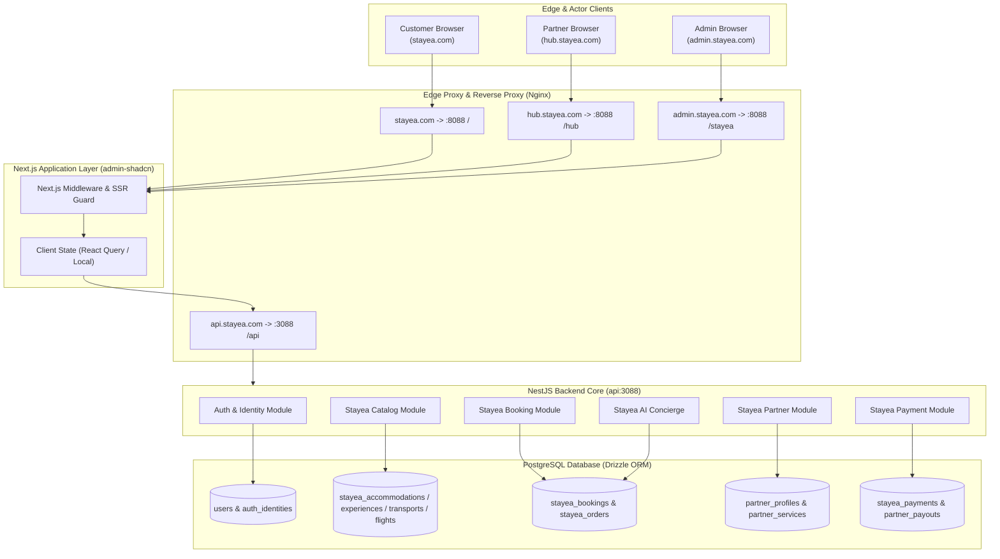
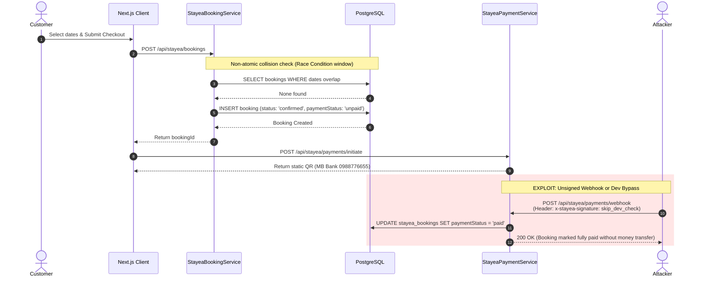
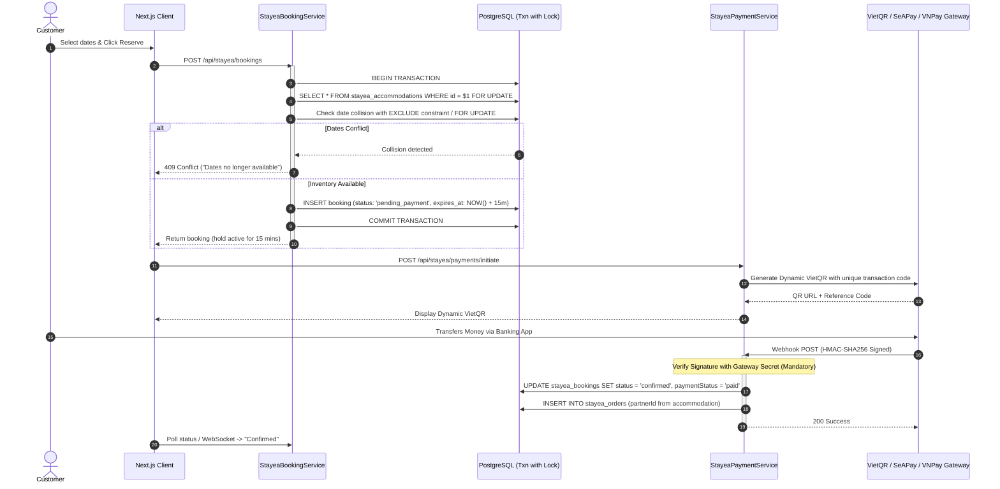
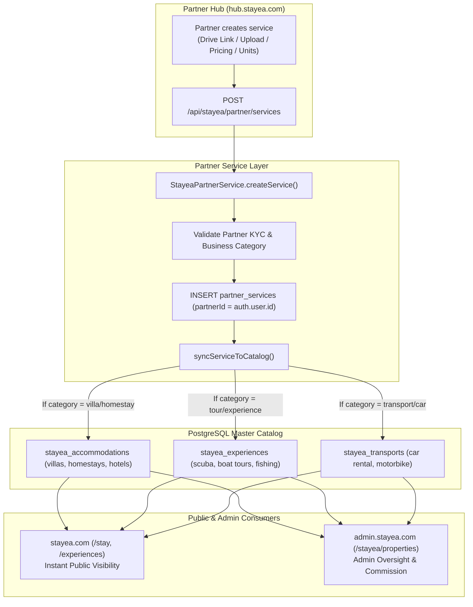
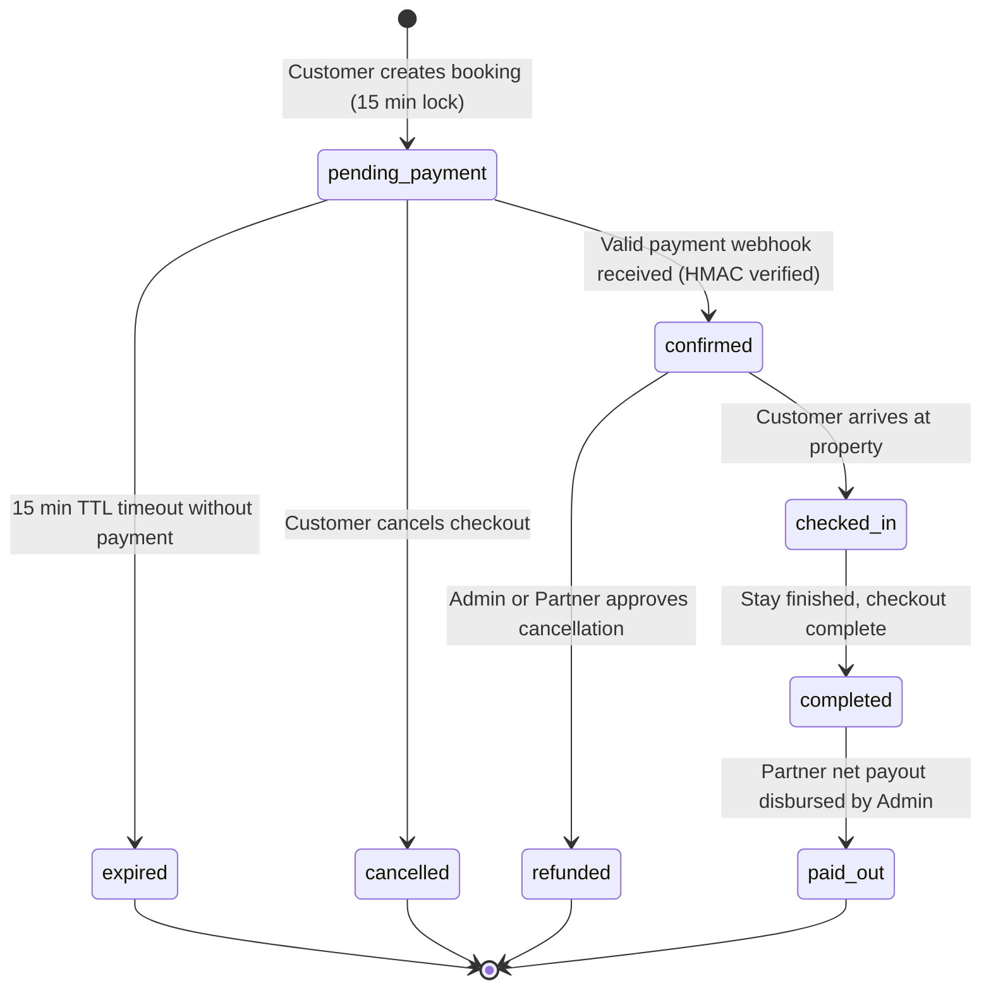
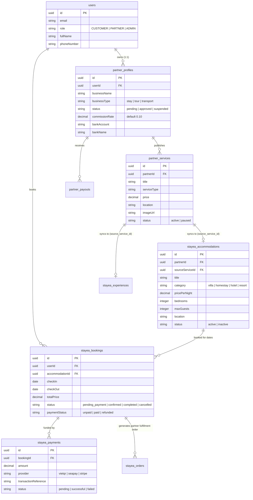

# STAYEA PLATFORM AUDIT: DOMAIN & DATA FLOW ARCHITECTURE
**Document ID:** `STAYEA-AUD-02`  
**Date:** 2026-11-02  
**Baseline Commit:** `f9c97a7`

---

## 1. High-Level System Architecture & Subdomain Boundary

STAYEA runs as a Turborepo monorepo with NestJS powering the core domain services and Next.js 16 (App Router) serving the web interfaces.

---

## 2. Booking & Payment Lifecycle (Current Flawed vs Target Architecture)

### 2.1 Current Flawed Flow (Vulnerable to Race Conditions & Unpaid Confirmation)

### 2.2 Target Hardened Flow (Phase 1 Remediation)

---

## 3. Partner Listing to Public Catalog Synchronization

When a partner registers a villa, homestay, or scuba diving tour in `hub.stayea.com`, the system automatically provisions catalog representations for public booking and admin moderation:

---

## 4. Booking State Machine

---

## 5. Entity Relationship Model (Core Stayea Schema)

