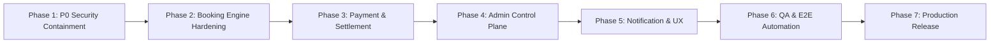

# STAYEA PLATFORM AUDIT: PHASED IMPLEMENTATION PLAN
**Document ID:** `STAYEA-AUD-05`  
**Date:** 2026-11-02  
**Baseline Commit:** `f9c97a7`

---

## 1. Implementation Philosophy & Governance Principles

1. **Zero Downtime & Safe Iteration:** Work is delivered in atomic, test-verified increments. Production state is never modified without prior test passage.
2. **No Data Fabrication:** Systems must reflect true transactional realities. No mock fallback data when real records are expected.
3. **Defense-in-Depth:** Every API endpoint validates authorization server-side. Frontend UI checks are for user experience only.
4. **Preserve Boilerplate & UI Aesthetic:** Do not rewrite frameworks or redesign Stayea visual components unnecessarily.

---

## 2. Roadmap Phases & Detailed Work Breakdown

---

### Phase 1: P0 Security & Trust Containment (Immediate Priority)
*Goal: Close all critical vulnerabilities that allow unauthorized admin access, free bookings, or data tampering.*

- **Task 1.1: Cryptographic Session Authentication & HttpOnly Cookie Migration**
  - Deprecate client-writable `user` JSON cookie in `apps/admin-shadcn/src/lib/server-user.ts`.
  - Update `AuthController` to issue JWT in an `HttpOnly`, `SameSite=Lax`, `Secure` cookie.
  - Implement Next.js SSR middleware session verification that verifies the token cryptographic signature or calls `GET /api/auth/me`.
  - Acceptance Criteria: Altering or injecting client cookie `user` does NOT grant access to `/stayea/*` or `/hub/*`.

- **Task 1.2: Payment Webhook Signature Enforcement**
  - Delete `skip_dev_check` and `process.env.NODE_ENV !== "production"` bypass branches in `stayea-payment.service.ts`.
  - Enforce HMAC-SHA256 signature verification on all incoming webhook payloads using `WEBHOOK_SECRET`.
  - Return HTTP 401 Unauthorized immediately for missing or invalid signatures.
  - Acceptance Criteria: Automated Vitest test sending unsigned POST to `/api/stayea/payments/webhook` receives HTTP 401.

- **Task 1.3: Booking Concurrency & State Machine Correction**
  - Move booking creation to status `pending_payment` with 15-minute expiration timestamp (`expires_at = NOW() + 15m`).
  - Wrap availability checks and booking insert in a PostgreSQL serializable transaction with `FOR UPDATE` lock.
  - Acceptance Criteria: Concurrent checkout test simulating two identical date reservations results in exactly 1 reservation granted and 1 collision error (`409 Conflict`).

- **Task 1.4: Partner Profile Access Control Fix**
  - Remove auto-creation of `approved` partner profiles in `StayeaPartnerService.getProfileByUserId`.
  - Unregistered users receive HTTP 404 with a prompt to submit a partner KYC application.
  - Fix partner ownership derivation in `stayea-booking.service.ts` to link orders directly to the owner of the accommodation booked.
  - Acceptance Criteria: Calling `/api/stayea/partner/profile` with a customer token returns HTTP 404; partner services remain cleanly partitioned.

- **Task 1.5: Secret Sanitization & Docker Compose Cleanup**
  - Remove hardcoded `JWT_SECRET` and database passwords from `docker/docker-compose.yml`.
  - Update `docker-compose.yml` to inject environment variables from root `.env`.
  - Correct `NEXT_PUBLIC_API_URL` handling for client-side and server-side container networks.
  - Acceptance Criteria: `docker-compose config` succeeds without exposed hardcoded keys.

---

### Phase 2: Booking Engine & Inventory Hardening
*Goal: Ensure 100% accurate physical inventory, prevent overbooking, and support blackout calendars.*

- **Task 2.1: Expired Booking Cleanup Worker**
  - Add a NestJS `@Cron("*/1 * * * *")` scheduled worker in `stayea-booking.service.ts`.
  - Query all bookings where `status = 'pending_payment'` and `expiresAt < NOW()`.
  - Update status to `expired` and release held inventory slots.
- **Task 2.2: Blackout Dates & Calendar Availability Persistence**
  - Introduce `stayea_inventory_blackouts` table schema in `@workspace/database`.
  - Add API endpoints `POST /api/stayea/partner/services/:id/blackout-dates` and `DELETE /...`.
  - Connect Partner Hub visual calendar to persist blocked dates.
- **Task 2.3: Booking Multi-Product Unification**
  - Standardize booking tables across villas, experiences, transports, and flights under unified order records.

---

### Phase 3: Payment Gateway & Dynamic VietQR Settlement
*Goal: Eliminate fake bank accounts and enable automated QR payment confirmation with real Vietnamese banking apps.*

- **Task 3.1: Dynamic VietQR Integration (VietQR.io / SeAPay / Casso API)**
  - Replace static MB Bank string with dynamic VietQR generator containing transaction prefix: `STAYEA<order_code>`.
  - Store payment reference in `stayea_payments` table with status `pending`.
- **Task 3.2: Automated Bank Transaction Webhook Processing**
  - Connect payment webhook to automatically match bank transfer description (`STAYEA<order_code>`) with pending payment.
  - Transition booking to `status = 'confirmed'` and `paymentStatus = 'paid'` atomically upon receipt of exact amount.
- **Task 3.3: Partner Payout Request System**
  - Add `partner_payout_requests` table and endpoints (`POST /api/stayea/partner/payouts/request`).
  - Partner Hub finance tab allows partners to submit withdrawal requests for cleared earnings.

---

### Phase 4: Admin Control Plane Completion
*Goal: Provide platform operators with genuine business intelligence and rigorous partner governance.*

- **Task 4.1: Real-Time Financial Aggregations & Charts**
  - Replace static `ADMIN_KPIS_VI` mock chart array with PostgreSQL `DATE_TRUNC('day', created_at)` aggregation.
  - Admin dashboard renders live daily revenue, active listings, and booking velocity.
- **Task 4.2: Partner KYC Approval Workflow**
  - Implement partner verification modal in `admin.stayea.com/stayea/partners`.
  - Admin can review business license, tax code, bank info, and approve or reject with custom notes.
- **Task 4.3: Catalog Moderation Workflow**
  - Add optional `moderation_status` (`pending_review`, `approved`, `rejected`) for partner listings.
  - Automatically notify partner when their villa or tour is approved for public display.

---

### Phase 5: Notifications & Travel Concierge UX
*Goal: Keep travelers and property hosts informed via transactional messaging and refine AI travel planning.*

- **Task 5.1: Transactional Email & Telegram/Zalo Host Alerts**
  - Send email confirmation to customer upon successful payment with booking PDF voucher.
  - Send instant Telegram/Zalo notification to partner when a new booking is confirmed.
- **Task 5.2: AI Concierge Rate Limiting & Safety Guardrails**
  - Implement NestJS Throttler guard on `POST /api/stayea/ai/chat` (max 20 messages / 5 minutes).
  - Add system prompt guardrails to prevent prompt extraction or arbitrary price manipulation.

---

### Phase 6: End-to-End QA Automation Suite
*Goal: Provide indisputable verification proof through automated test pipelines.*

- **Task 6.1: API Integration Test Suite (Vitest)**
  - Full automated coverage for:
    - Customer booking creation $\rightarrow$ Dynamic QR generation $\rightarrow$ Webhook confirmation.
    - Partner listing creation $\rightarrow$ Catalog sync $\rightarrow$ Admin visibility.
    - Security penetration tests: Cookie tampering, Webhook forgery, Overbooking race condition.
- **Task 6.2: Playwright E2E Multi-Role Suite**
  - Role A (Customer): Browse Phu Quoc villas, select dates, initiate checkout.
  - Role B (Partner): Log in to `hub.stayea.com`, create listing with Drive image, accept incoming order.
  - Role C (Admin): Log in to `admin.stayea.com`, approve partner, inspect real revenue counters.

---

### Phase 7: Production Readiness & Release
*Goal: Deploy hardened, production-grade release to VPS with zero downtime and strict secrets management.*

- **Task 7.1: Environment Variable & Secrets Audit**
  - Rotate all JWT secrets and database passwords on production VPS (`157.66.100.35`).
  - Update PM2 ecosystem configuration with production environment variables.
- **Task 7.2: Nginx SSL & Subdomain Hardening**
  - Obtain and configure automated Let's Encrypt SSL certificates for:
    - `stayea.com`
    - `hub.stayea.com`
    - `admin.stayea.com`
    - `api.stayea.com`
  - Add security headers (HSTS, X-Frame-Options, CSP, CORS origin whitelisting).
- **Task 7.3: Database Backup & Rollback Protocol**
  - Configure daily automated PostgreSQL pg_dump backups to remote S3 storage.
  - Document zero-downtime rollback runbook.

